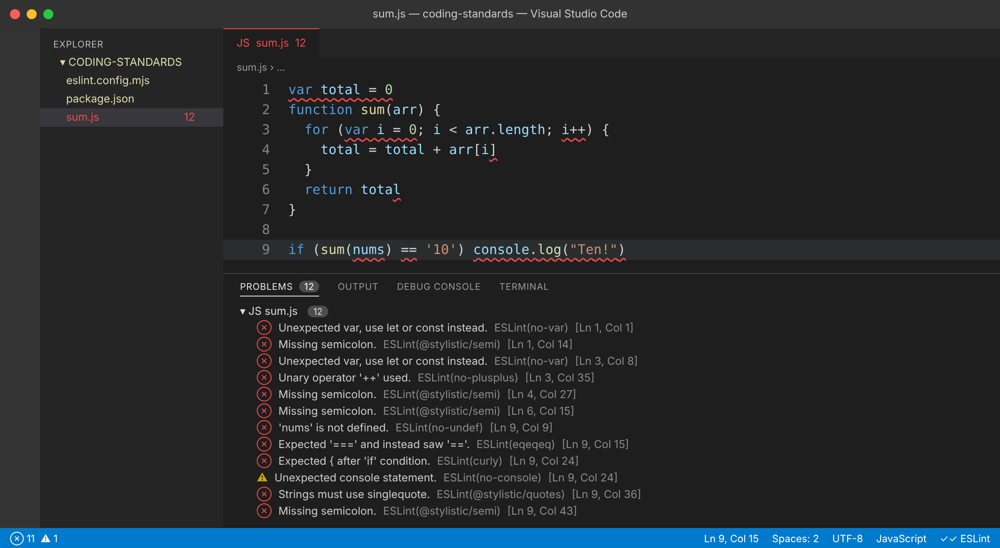

## Subject lines in all caps

Before I ever wrote a line of TypeScript, I spent four years as an administrative clerk in the United States Marine Corps. A lot of that job was paperwork: awards, promotions, mail, travel orders, and official letters. Every one of those letters followed the Navy Correspondence Manual, SECNAV M-5216.5. The manual dictates where the "From" and "To" lines go, how paragraphs are numbered, and that the subject line goes in ALL CAPS. If a letter came across my desk with the margins wrong, it went back, even when the content was perfect.

As a young Marine I thought this was the purest example of bureaucracy there was. Who cares where the subject line sits? It took me a while to see the point. When thousands of people across the world are writing and reading the same kinds of documents, a fixed format means nobody wastes time hunting for the important part. A commander reading a stack of award packages knows exactly where to look on every page. The format isn't the work, but it makes the work readable at scale.

So when ICS 314 introduced coding standards and ESLint, I had a strange sense of déjà vu.

## More than spaces and curly braces

A lot of people hear "coding standards" and think of the trivial stuff: two spaces or four, whether the closing brace gets its own line, single quotes or double quotes. Those rules exist, and honestly, the specific choice usually doesn't matter much. What matters is that *everyone makes the same choice*, so that reading someone else's code feels like reading your own.

But the more interesting rules aren't about appearance at all. They're about behavior. Consider this snippet, which is the kind of thing I might have written back when I was learning C++ and treated JavaScript like a looser version of it:

```js
var total = 0
function sum(arr) {
  for (var i = 0; i < arr.length; i++) {
    total = total + arr[i]
  }
  return total
}

if (sum(nums) == '10') console.log("Ten!")
```

This code runs. It might even give the right answer the first time. ESLint, however, lights it up like a Christmas tree: `no-var`, `eqeqeq`, `no-plusplus`, `prefer-const`, missing semicolons, double quotes, and missing curly braces. My first reaction to a wall of red squiggles like that was the same reaction I had to a returned letter: *it works, why do you care?*

Then I started reading the reasons behind the rules.

## The linter as a teacher

This is where I've come to agree that coding standards can actually teach you a language. Each ESLint rule is a small lesson about a pitfall someone has already fallen into.

- **`eqeqeq`** forced me to understand type coercion. In JavaScript, `10 == '10'` is `true`. That one rule sent me down a rabbit hole about how loosely JavaScript compares values, and why `===` exists in the first place.
- **`no-var`** made me learn the difference between function scope and block scope. In the code above, `total` lives outside the function, so calling `sum` twice quietly doubles the result. `var` doesn't cause that bug, but the habit of thinking about scope does prevent it.
- **`prefer-const`** changed how I think about variables. Declaring something `const` is a promise to the next reader that this value won't change. When I see `let`, I now know to pay attention.
- **`no-plusplus`** confused me at first, since `i++` is second nature coming from C++. The reasoning is that automatic semicolon insertion can do surprising things around `++`, and the rule pushes you toward array methods like `reduce`, `map`, and `forEach` that say what you mean instead of how to loop.

After fixing everything, the same logic looks like this:

```ts
const sum = (arr: number[]): number => arr.reduce((acc, n) => acc + n, 0);

if (sum(nums) === 10) {
  console.log('Ten!');
}
```

It's shorter, it has no shared mutable state, the types document themselves, and the comparison does exactly what it says. I didn't learn to write it this way from a lecture. I learned it by being told "no" by a tool, over and over, until I understood why.

## My first week with ESLint: painful *and* useful

I'll be honest: the first few days were frustrating. There's a particular kind of annoyance in finishing a WOD, feeling good that your code works, and then seeing a column of yellow and red warnings telling you that you're not actually done. Some of the errors felt petty, like a line being a few characters too long or imports being in the "wrong" order.

But a few things changed my mind quickly:

1. **ESLint caught real bugs.** More than once, a `no-unused-vars` warning turned out to be a typo, where I'd declared one variable and then used a slightly different name. Without the linter, that's a confusing runtime error ten minutes later.
2. **Fixing errors got fast.** By the end of the week I was making fewer of them in the first place. The rules stopped being something I checked after writing code and started being how I write code. That's exactly what happened with naval correspondence: eventually you don't look up the format, you just type it correctly.
3. **It takes ego out of the conversation.** If a teammate tells me my code is messy, that's personal. If ESLint flags it, that's just the standard. The tool becomes the bad guy, so humans can spend code review talking about design and logic instead of semicolons.

## A parallel from my day job

I now work as a point cloud processor, turning LiDAR scans into 2D CAD deliverables. My company has its own layer standard, and every feature in a drawing, whether it's a top-of-curb line, a manhole, or a water valve, has to go on its designated layer with the right name. Put a feature on the wrong layer and the drawing might *look* fine, but the next person who filters by layer, or the client who imports it into their own system, gets the wrong result.

That's the same lesson as the Marine Corps letters and the same lesson as ESLint. Standards matter most when your work is going to be consumed by people and tools you'll never meet. Code is no different. Most of the code I write this semester will be read far more often than it's written, by teammates, by graders, and by future me at 1 a.m. trying to remember what I was thinking.

## If you could only pick one technique

Would I pick coding standards as the *single* software engineering technique to adopt? I mostly agree, with a caveat. Coding standards don't prove your code is correct. A program can be perfectly lint-clean and still give the wrong answer; that's what testing is for. If correctness were the only goal, I'd probably pick testing.

But coding standards have one huge advantage: they are almost free. Once ESLint is configured, it runs on every save, gives feedback in milliseconds, and never gets tired or moody. Tests have to be written and maintained. Code reviews require another person's time. A linter works from minute one, scales to any team size, and quietly teaches everyone on the team the same good habits. For the cost, I can't think of a technique with more leverage.

## Final thoughts

I used to see the Navy Correspondence Manual as a pile of rules about margins. Now I see it as a system that let a huge organization communicate clearly. I'm starting to see ESLint the same way. The red squiggles are annoying, but they're also a running conversation with every developer who hit a bug before me and wrote a rule so I wouldn't have to. A week in, I don't love every rule, but I trust the system, and my code is better for it.

## Use of AI

I used Claude to help draft this essay. I provided my background, including my Marine Corps experience with naval correspondence, my job processing LiDAR data and following CAD layer standards, and my programming background, and Claude helped organize those ideas into a structured draft and write example code. I then reviewed and edited the draft so that it reflects my own experience and opinions about coding standards and ESLint.