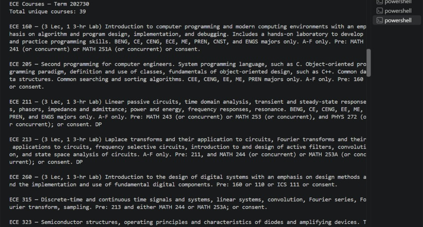

## Overview
Class Detective is a service for students to easily search for classes that they are eligible for. Rather than sifting through Star GPS, they can upload their transcript and instantly see their available courses.

## Proposers
Jenna Harrison, Evan Morgan, John Leevi Domingo, and Charles Thompson

## Mockup Page Ideas
To use Class Detective, a new user must first register and login to their account. Once logged in, they will be able to access the landing page.

The landing page will serve as the ‘main’ page of the website, allowing users to navigate to various pages and access different functionalities. It will also display a welcome message.

The course display page lets users search for and filter courses to find courses that they are eligible for. Upon finding a course that the user is interested in, they may select it to learn more information about it.

Users may also manually enter courses they have already taken to filter out classes that require pre-requisites they have not completed. This way, the user is only seeing classes that they are able to take.

- Home page
- Register page (Make an account)
- Login page (Enter account info)
- Landing page (Welcome page with tabs to access functionalities)
- Search classes
- Course display page (shows everything you can possibly take)

## Proof of concept:

  
  
<small>Extracting data from University of Hawaii at Manoa Course Catalog</small>

## Use case ideas
- New user creates an account
- User logs in
- User uploads their transcript
- User can search for eligible classes

## Beyond the Basics
After basic functionality is complete, here are several advanced features:
- Sort classes by professor
- Rate my professor
- Filter by campus and semester
- View past transcripts
- Upload new transcripts
- Sort by professor
- Account management (Change password, email, profile picture)
